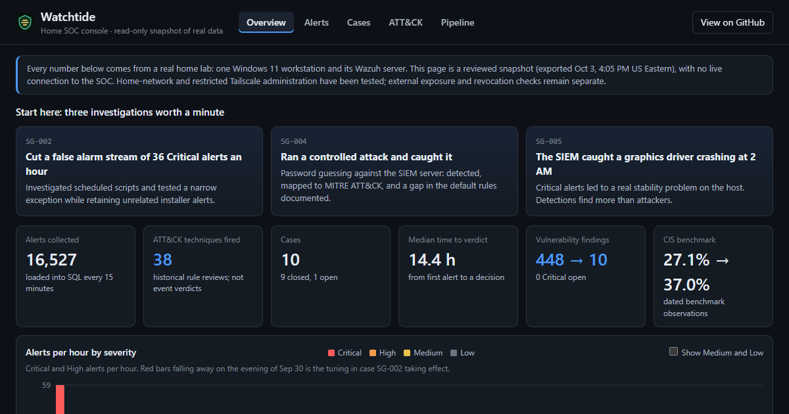

# Watchtide: An Evidence-Led Home SOC

By Jordan Carven-Bellace. Publication copy prepared October 11, 2026.
Home lab and analyst-learning portfolio; not a managed service or enterprise SOC.

## Overview

Watchtide connects Windows security telemetry to investigation and reporting.
Sysmon and Windows logs feed a Wazuh agent, an Ubuntu Hyper-V SIEM, a SQL Server
warehouse and a six-page Power BI report. Controlled Suricata tests add network
evidence on a measured path. A public console presents a separately sanitized,
historical snapshot without a live connection to the private system.

The project demonstrates detection tuning, pipeline troubleshooting, SQL
reporting, controlled validation and evidence-based analyst decisions. The aim
is not to accumulate tools or claim every attack is covered. It is to explain
what was observed, how it moved through the system and what each result proves.

[Explore the public console](https://jordan17133.github.io/Watchtide/) |
[Browse the source and evidence](https://github.com/jordan17133/Watchtide)



The console image uses the snapshot exported October 3, 2026 at 20:05:21 UTC.
Its alert, case and posture figures are historical, not current system counts.
The image contains public, sanitized data; it is not a new live dashboard capture.

## The Engineering Problem

A security alert is useful only when its origin, context and delivery are
understood. Three problems shaped this build: routine activity dominated the
Critical queue, a successful database load could conceal stale endpoint data,
and report refreshes could collide with the loader's writes. Each needed a
specific investigation rather than a broad suppression or another dashboard.

## Architecture And Boundaries

```text
Windows telemetry -> Wazuh agent -> Ubuntu manager -> Filebeat -> Indexer
                                                               |       |
                                                    Wazuh dashboard    |
                                                                       v
                                           restricted SSH/TLS read -> SQL
                                                                       |
                                                                       v
                                                             Power BI import

Controlled Suricata packet test -> EVE alert -> Wazuh -> same reporting path
Local watchdog -> SQL health/review observations -> generic Windows notice
Public console <- independently sanitized historical snapshot
```

The warehouse copies alert documents, not every packet or raw event. Power BI
reflects its last import. Wireshark/TShark explains saved packets; Nmap checks
selected services or creates separately authorized test traffic. Neither is an
automatic warehouse feed. [Interaction and triage map](../triage-system-audit.md).

## Selected Work And Results

### Investigate Before Tuning

The September 30 investigation found that 478 of 506 alerts in the original
Critical cluster were PowerShell execution-policy probe writes. The narrow
child rule required both the reviewed writer path and exact temporary-file
pattern; unrelated installer activity retained its severity. That historical
94% cluster is not a claim that 94% of all future alerts are false positives.
Events remained recorded at lower priority, with residual impersonation risk
documented. [Investigation and tuning boundary](../../triage/2026-09-30-rule-92213-powershell-policy-test-noise.md).

### Prove Collection Recovery, Not Just A Green Service

The October 7 outage investigation identified one obsolete manager-name mapping.
A bounded repair preserved unrelated configuration and restarted only the Windows
agent. Two benign Sysmon records then matched their Indexer documents, SQL payloads
and reporting-view identities through the normal scheduled loader. This proves
that recovery path, not restoration of records previously lost upstream.
[Exact trace and remaining source-health gates](../collection-health-validation.md).

### Validate A Network Rule With A Nonmatch

The October 7 bounded Suricata trial captured one marked and one unmarked ICMP
request. The marked request produced one alert; the control produced none.
Both captures reported zero kernel drops, and independent packet inspection
checked their fields and alert time. The saved alert was separately traced into
Wazuh, the Indexer and normal-loader SQL. This was two controlled requests, not
continuous browsing or whole-home monitoring. [Trial](../suricata-live-trial.md),
[saved-live reporting trace](../suricata-live-reporting-handoff.md).

### Make Reporting Recoverable And Usable

A confirmed Power BI/loader deadlock led to a guarded committed-snapshot reading
change in a quiet maintenance window. All six report pages rendered after the
October 5 refresh; later saved-live-record Desktop verification remains open.
The October 7 same-instance restore drill recovered 37,605 alert rows with a
clean integrity check and 20 readable SQL views. It did not establish off-PC or
full-SOC disaster recovery. [Refresh diagnosis](../report-refresh-reliability.md),
[restore evidence](../sql-recovery-validation.md).

### Monitor The Monitoring

The local watchdog was deployed October 8. It checks selected collection/read
signals and produces generic Windows notices without raw event details. Its
October 11 task metadata was independently checked; permissions, notification
eligibility and actual reboot/logon behavior still need review. A successful
task exit is not proof that every source is healthy or every notice was seen.
[Deployment record](../collection-watchdog.md),
[current review boundaries](../current-state-reconciliation.md).

## What This Demonstrates

- Detection engineering: scoped conditions, positive/nonmatch controls and honest
  separation of severity, historical research and an event-specific verdict.
- Troubleshooting: source-to-report identity checks and failure diagnosis across
  Windows, Linux, SSH/TLS, Wazuh, SQL and reporting clients.
- Data engineering: scheduled ingestion, reporting views, guarded concurrency
  fixes and a tested local restoration rather than assumed recoverability.
- Operational judgment: bounded changes, preserved rollback evidence, public/
  private separation and explicit unfinished validation gates.

Implementation and review used AI assistance. The lab's public claims remain
bounded by documented evidence; approved operator deployments and controlled
tests are distinguished from prepared code or another agent's summary.

## Current Limits And Continuation

The private SIEM is not exposed through the portfolio or public console.
Historical rule reviews do not classify future events. Hyper-V NAT does not
provide whole-home visibility, and Tailscale enrollment does not automatically
route ordinary browsing through privacy VPN egress.

The first open work is the deployed watchdog's policy/read-scope review. Seven
TCP examples are prepared and decoded, but installed-engine validation remains
open. Fresh saved-live Power BI rendering, measured routine traffic coverage,
off-PC recovery and disk/boot protection also retain separate gates.
[Current status](../../STATUS.md#current-snapshot) and
[execution order](../../ROADMAP.md#current-execution-order) are authoritative.
